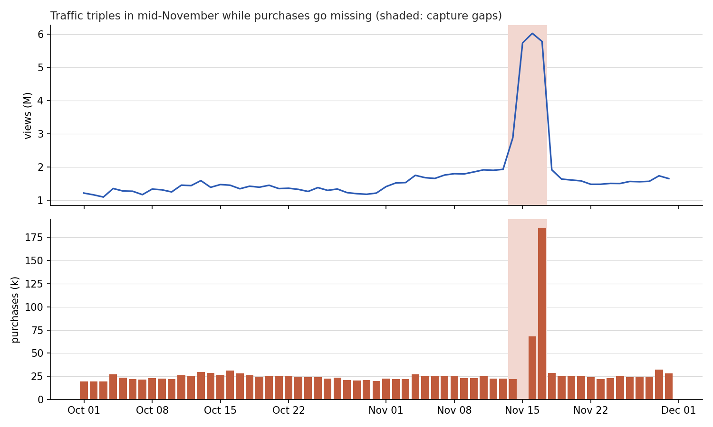
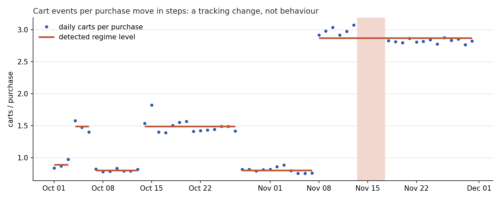
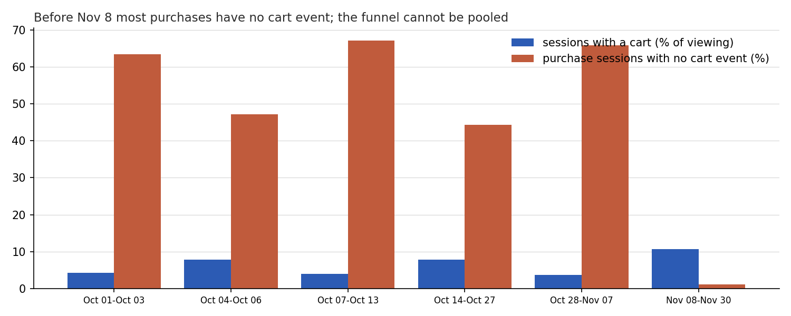
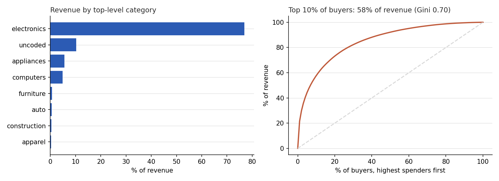
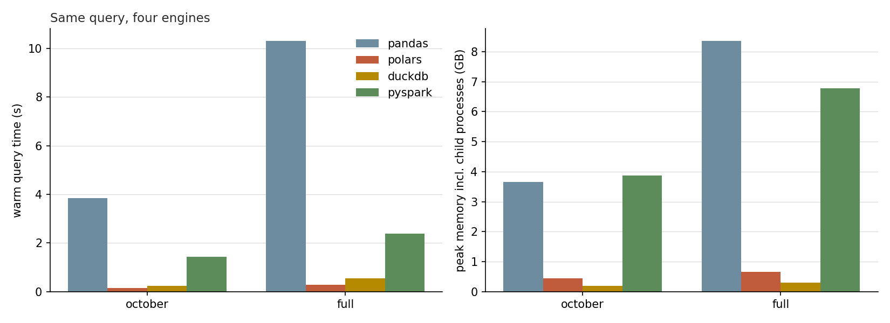

[English ] | [[Español](README.es.md) ]

# E-commerce Lakehouse on 110 Million Real Events


Two months of clickstream from a real multi-category online store, 110 million events in 14.7 GB of CSV, turned into a day-partitioned Parquet lake with DuckDB and queried in place. Before reporting a single funnel or revenue figure, the pipeline checks whether the logging itself is stable, and in this dataset it is not: **purchases go unrecorded for 48 busy hours in mid-November, and cart events are tracked under six different regimes**. A funnel pooled over the two months would be measuring the tracking, not the customers.

## Data

[eCommerce behavior data from multi category store](https://www.kaggle.com/datasets/mkechinov/ecommerce-behavior-data-from-multi-category-store) (Kaggle, data from the REES46 / Open CDP project), files `2019-Oct.csv` and `2019-Nov.csv`, downloaded on 2026-10-08. Each row is one `view`, `cart` or `purchase` event with product, category, brand, price, user and session.

**License: "copyright-authors".** The raw data is not in this repository and is not redistributed; `src/sources.py` downloads it with your own Kaggle token. Only aggregates computed from it are published here (`reports/*.json`, the figures).

## Pipeline

```
2019-Oct.csv + 2019-Nov.csv  (14.7 GB)
        │  src/sources.py — Kaggle API download
        ▼
src/lakehouse/ingestion.py — DuckDB streams CSV → Parquet, cleaning in SQL
        │  exact duplicates removed, prices <= 0 nulled, no-session events dropped,
        │  top_category derived, pydantic contract checked on a sample
        ▼
data/lakehouse/events/year=2019/month=10/day=01/…   (61 partitions, ZSTD)
        │
        ▼
src/lakehouse/analytics.py — capture gaps → tracking regimes → funnels, revenue,
        │                     concentration, retention (all SQL over the lake)
        ▼
reports/results.json → src/make_figures.py → outputs/figures/
src/benchmark.py — same query in pandas, Polars, DuckDB and PySpark
```

Building the lake from the two CSVs takes about 3.5 minutes on an 8-core desktop and never holds the data in memory; every analytical query below runs in under a minute over all 110 million rows.

## What the raw data contains

| Check | Events |
|---|---:|
| Raw events | 109,950,743 |
| Exact duplicate rows (removed) | 130,739 |
| Price zero or negative (price nulled, event kept) | 256,761 |
| No session id (removed) | 12 |
| No `category_code` (kept as `uncoded`) | 35,413,780 |
| **Events in the lake** | **109,819,992** |

A third of events have no category code. The dataset description says the store only codes "meaningful" categories; they are kept and shown as their own `uncoded` group rather than dropped, since they carry 10.2% of revenue.

## Finding 1: purchases are missing for four days



An hour of this store with at least 5,000 events and zero purchases is not a quiet hour; the quietest normal hours still record purchases. By that rule, **48 hours on November 14–17 are capture gaps**: November 15 has 468 thousand cart events and not one purchase, November 16 records purchases only between 08:00 and 15:00 UTC, and November 17 records them only from 03:00. Those days also carry 3.5 times the normal daily views, so a real sales event happened and the purchase log failed during it.

The consequence is that the "record day" in this data, November 17 at 57.8 million in revenue (8 times the 7.16 million daily median), cannot be read as one: some of it is demand, some of it may be purchases from the missing hours landing late, and the data cannot separate the two. The four days are flagged and excluded from the funnels, the revenue shares and the concentration figures.

## Finding 2: cart tracking changes six times



Daily purchases are flat for the two months, but cart events per purchase jump from one day to the next: 0.89, then 1.49, 0.80, 1.49, 0.80 and finally 2.87 from November 8. Binary segmentation on the daily log ratio finds exactly those six regimes (a split is kept only while it separates levels at least 30% apart). Customers do not change their basket habits overnight, and the alternation between two levels looks like a second cart-event source being switched on and off.



The session funnel shows what that does. Up to November 7, **44% to 67% of purchasing sessions contain no cart event at all**, depending on the regime; from November 8 it is 1.2%. The cart step only became a reliable funnel step on November 8. Before that, a "view → cart → purchase" conversion rate would have been dividing by a number the tracking was not recording.

## Finding 3: who buys



- **Electronics is 76.9% of revenue**, then `uncoded` (10.2%), appliances (5.6%) and computers (4.8%).
- **Spending is concentrated**: the top 1% of 589,820 buyers account for 21.5% of revenue and the top 10% for 57.7% (Gini 0.70).
- **46.4% of October's visitors come back in November**; of October's buyers, 26.3% buy again in November. The second number is biased low by the November gaps and is reported as a lower bound.
- 35.7% of buyers purchase in more than one session.

## Engine benchmark

`src/benchmark.py` runs one query, revenue, purchases and distinct buyers per category over purchases only, in each engine, each in a fresh subprocess. Memory is the peak resident size of that process plus its children, sampled every 50 ms, so it includes the JVM PySpark starts. One cold run, then the best of three warm runs; Spark's session start-up (about 2.7 s) is timed separately. All four engines return the same answer to the cent.



| Scope | Engine | Cold (s) | Warm (s) | Peak memory (GB) |
|---|---|---:|---:|---:|
| october | pandas | 4.12 | 3.84 | 3.65 |
| october | polars | 0.43 | 0.15 | 0.44 |
| october | duckdb | 0.68 | 0.23 | 0.19 |
| october | pyspark | 7.84 | 1.44 | 3.87 |
| full | pandas | 10.67 | 10.30 | 8.35 |
| full | polars | 0.50 | 0.30 | 0.66 |
| full | duckdb | 0.94 | 0.55 | 0.30 |
| full | pyspark | 9.54 | 2.38 | 6.77 |

- **Polars and DuckDB answer in well under a second over 110 million rows**, because both read only the four needed columns and push the purchase filter into the Parquet scan. Polars is faster warm (0.30 s against 0.55 s on the full lake); DuckDB uses half the memory (0.30 GB against 0.66 GB).
- **pandas is 35 times slower than Polars on the full lake** and peaks at 8.35 GB: it has to materialise every row of the four columns as Python objects before it can filter. Its memory grows with the rows it reads, 3.65 GB for October and 8.35 GB for both months.
- **PySpark is the slowest of the three columnar engines here** and peaks at 6.77 GB including its JVM. That is the expected result on one machine: Spark's cost is coordination and serialisation that only pays off once the data does not fit on one node. This benchmark shows the single-node floor, not Spark's case.
- The query is selective (purchases are 1.5% of events), which favours engines with filter pushdown. A query that must read every row, or a large join, is a different test and could order Polars, DuckDB and Spark differently; it was not run here.

## Reproduce

```bash
python -m venv .venv
.venv\Scripts\activate           # Linux/macOS: source .venv/bin/activate
pip install -r requirements.txt

python -m src.sources              # needs a Kaggle API token in ~/.kaggle
python -m src.lakehouse.ingestion  # builds the lake, writes reports/ingestion.json
python -m src.main                 # all metrics -> reports/results.json -> figures
python -m src.benchmark            # optional, ~15 min; PySpark needs JAVA_HOME
pytest
```

The tests run on a 12-row fixture in the REES46 format, so CI needs neither the dataset nor Java. `tests/test_readme.py` checks the figures quoted in this README against `reports/results.json`.

## Limitations

- The gap rule is a threshold, and a gap shorter than an hour or in a quiet hour would pass unseen. It is tuned to this store's volume.
- Regime detection uses daily ratios; a tracking change within a day is dated to the nearest day boundary.
- Prices are in the store's currency as published, with no conversion or deflation.
- Sessions are the ids the store assigned; no re-sessionization by inactivity was attempted.
